# Kimodo Animation (Unreal Engine 5.8 Editor Plugin)

텍스트 프롬프트 한 줄로 동작을 만들어, 내 프로젝트의 스켈레탈 메시에 맞는 `AnimSequence`로 저장하는 **에디터 전용** 플러그인입니다.
NVIDIA의 모션 생성 모델 [Kimodo](https://github.com/nv-tlabs/kimodo)를 **내 PC에서 로컬로** 실행하며, 생성·리타게팅·미리보기·저장을 UE 에디터 패널 하나에서 처리합니다.

버전 **1.1.1** · 변경 내역은 [CHANGELOG.md](CHANGELOG.md) · 라이선스 [MIT](LICENSE)

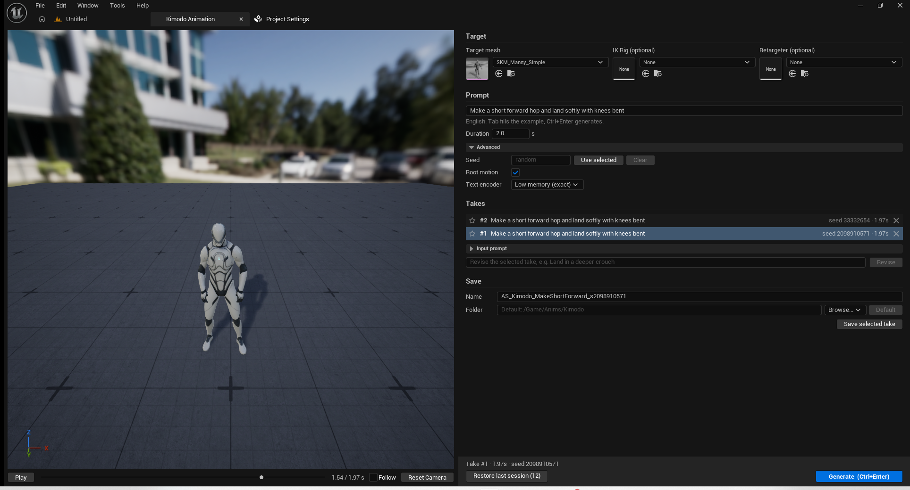

```
"Walk forward four steps"
   │  (선택) CLI 에이전트가 영어 동작 설명으로 다듬기
   ▼
Kimodo (로컬 Python)  ──▶  SOMA 스켈레톤 모션 (BVH → glTF)
   ▼
UE: glTF 가져오기 → IK Retargeter로 대상 메시에 리타게팅 → 패널에서 미리보기
   ▼
Save → /Game/... 의 AnimSequence
```

---

## 목차

1. [요구 사항](#요구-사항)
2. [설치](#설치)
3. [Kimodo 설치 (패널에서 한 번)](#kimodo-설치-패널에서-한-번)
4. [빠른 시작](#빠른-시작)
5. [프롬프트 작성 요령](#프롬프트-작성-요령)
6. [패널 사용법](#패널-사용법)
7. [루트 모션](#루트-모션)
8. [테이크와 저장 위치](#테이크와-저장-위치)
9. [텍스트 인코더와 메모리](#텍스트-인코더와-메모리)
10. [설정 항목](#설정-항목)
11. [파일과 폴더](#파일과-폴더)
12. [문제 해결](#문제-해결)
13. [제한 사항](#제한-사항)
14. [제거](#제거)
15. [라이선스](#라이선스)

---

## 요구 사항

| 항목 | 내용 |
|---|---|
| 엔진 | **Unreal Engine 5.8**, Windows 64-bit. Blueprint 프로젝트와 C++ 프로젝트 모두 가능([어떤 zip을 받을지](#어떤-zip을-받을까)) |
| 빌드 도구 | 빌드된 zip(`-Win64-UE5.8`)을 쓰면 **필요 없음**. 소스 zip은 Visual Studio(“C++를 사용한 게임 개발” 워크로드)와 Windows SDK 필요 |
| GPU | **NVIDIA GPU 권장**(CUDA 12.8 PyTorch). 없으면 CPU용 PyTorch로 설치되며 생성이 느려집니다 |
| RAM | 기본 설정(Low memory)에서 생성 중 약 **3 GB** 추가 사용. 16 GB PC에서도 동작 |
| 디스크 | 약 **20 GB**(PyTorch 약 3 GB + Llama 3 8B 약 16 GB + Kimodo 모델). 기본 위치 `%LOCALAPPDATA%\KimodoAnimation\` |
| 계정 | **Hugging Face 계정**, [`meta-llama/Meta-Llama-3-8B-Instruct`](https://huggingface.co/meta-llama/Meta-Llama-3-8B-Instruct) 라이선스 승인, **읽기(Read) 토큰** |
| 인터넷 | 설치할 때만 필요. 설치 후 생성은 오프라인으로 동작 |

> UE에 내장된 Python 3.11을 쓰므로 별도 Python 설치는 필요 없습니다.
> Windows / Python 3.11용 `kimodo` 사전 빌드 휠(`Wheels/`)이 동봉되어 있어 CMake·Git·MSVC로 Kimodo를 컴파일하지 않습니다.

---

## 설치

### 어떤 zip을 받을까

[Releases](https://github.com/Garagekeeper/UE_Kimodo_AnimPlugin/releases)에는 zip이 두 개 있습니다.

| zip | 들어 있는 것 | 이런 경우에 |
|---|---|---|
| **`KimodoAnimation-<버전>-Win64-UE5.8.zip`** (빌드됨) | 미리 컴파일한 플러그인 DLL + 소스 | **Blueprint 프로젝트**, 또는 Visual Studio 없이 쓰고 싶을 때. UE **5.8.0** 전용 |
| `KimodoAnimation-<버전>.zip` (소스) | 소스만. 프로젝트를 열 때 직접 빌드 | C++ 프로젝트, 다른 5.8.x 핫픽스, 코드를 고쳐 쓸 때 |

- 빌드된 zip은 엔진 버전이 정확히 맞아야 합니다. 프로젝트를 열 때 “모듈을 다시 빌드할까요?” 창이나 “다른 엔진 버전으로 빌드됨” 메시지가 뜨면 소스 zip을 쓰세요(Visual Studio 필요).
- Blueprint 프로젝트에서 소스 zip을 쓰려면 먼저 `Tools > New C++ Class…`로 빈 클래스를 하나 추가해 C++ 프로젝트로 바꿔야 합니다.

### 다운로드해서 넣기

1. 위 표를 보고 zip을 받습니다.
2. 압축을 `<프로젝트>/Plugins/`에 풉니다(`Plugins` 폴더가 없으면 만듭니다). zip 안의 `KimodoAnimation` 폴더가 그대로 생기고, 그 바로 아래에 `KimodoAnimation.uplugin`이 있어야 합니다.

```
<프로젝트>/
  Plugins/
    KimodoAnimation/
      KimodoAnimation.uplugin
      Binaries/   ← 빌드된 zip에만 있음
      Scripts/  Source/  Wheels/ ...
```

3. 프로젝트를 Git으로 관리한다면 이 폴더를 그대로 커밋합니다. 휠(`Wheels/*.whl`, 약 28 MB)은 플러그인에 들어 있는 `.gitattributes` 때문에 Git LFS로 올라갑니다(프로젝트에 Git LFS 설치 필요).

> **주의**: GitHub의 `Code > Download ZIP`이나 태그의 `Source code (zip)`은 Git LFS 파일을 포함하지 않아, 휠 대신 작은 텍스트 파일이 들어 있습니다. 반드시 Releases에 첨부된 zip을 받으세요. `Wheels/*.whl`이 약 28 MB인지로 확인할 수 있습니다.

### 업데이트

1. 에디터를 닫습니다.
2. 기존 `Plugins/KimodoAnimation/` 폴더를 지우고, 새 버전 zip을 같은 위치에 풉니다(덮어쓰기만 하면 지워진 파일이 남을 수 있음).
3. 프로젝트를 엽니다(소스 zip이면 플러그인 C++ 모듈을 다시 빌드). 테이크 캐시, 설정, 설치한 Kimodo(`%LOCALAPPDATA%\KimodoAnimation\`)는 그대로 유지됩니다.

변경 내용은 [CHANGELOG.md](CHANGELOG.md)에서 확인합니다.

### 빌드와 활성화

1. 프로젝트(`.uproject`)를 엽니다.
   - 빌드된 zip: 바로 열립니다.
   - 소스 zip: 모듈 빌드 창이 뜨면 **Yes/Build**를 누릅니다(또는 Visual Studio에서 `<프로젝트>Editor` 타깃을 빌드).
2. `PythonScriptPlugin`, `IKRig`, `Interchange`, `KimodoAnimation`은 자동으로 켜집니다.
3. 메뉴 **`Tools > Kimodo Animation`**으로 패널을 엽니다.

---

## Kimodo 설치 (패널에서 한 번)

패널을 처음 열면 **Install Kimodo** 영역이 보입니다. Kimodo가 설치되어 있으면 이 영역은 숨겨집니다.

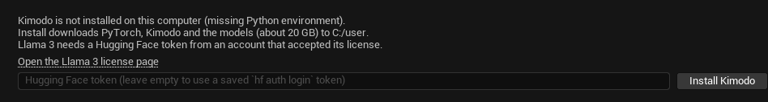

1. Hugging Face에서 [Llama 3 8B Instruct 라이선스를 승인](https://huggingface.co/meta-llama/Meta-Llama-3-8B-Instruct)합니다(승인까지 시간이 걸릴 수 있음).
2. [Hugging Face 설정 > Access Tokens](https://huggingface.co/settings/tokens)에서 **Read** 토큰을 만듭니다.
3. 패널의 토큰 칸에 붙여 넣고 **Install Kimodo**를 누릅니다.

설치 단계(진행 막대와 로그 마지막 줄이 패널에 표시됨):

| 단계 | 내용 |
|---|---|
| Checking Llama 3 access | 토큰으로 Llama 3에 접근할 수 있는지 먼저 확인 |
| Creating the Python environment | `%LOCALAPPDATA%\KimodoAnimation\venv` 생성 |
| Installing PyTorch | NVIDIA GPU가 있으면 CUDA 12.8 빌드(약 3 GB), 없으면 CPU 빌드 |
| Installing Kimodo | 동봉 휠 설치(SHA256 확인). 휠을 쓸 수 없으면 GitHub 소스에서 빌드 |
| Downloading … | Llama 3 8B, LLM2Vec 어댑터, Kimodo 모델을 `model-cache`로 다운로드 |

- 토큰은 설치 과정에서만 쓰며 로그에 남기지 않습니다.
- 중간에 실패해도 다시 누르면 이미 받은 것은 건너뜁니다. 상세 로그는 `Saved/Kimodo/PanelJobs/<작업 id>/Setup.log`에 있습니다.
- 설치 위치를 바꾸려면 [설정 항목](#설정-항목)의 `Python Executable`, `Model Cache Directory`를 지정합니다.

---

## 빠른 시작

1. **Target**에서 대상 스켈레탈 메시를 고릅니다(예: `SKM_Manny_Simple`). IK Rig와 Retargeter는 비워 두면 자동입니다.
2. **Prompt**에 영어로 동작을 적습니다. 예: `Wave the right hand`, `Walk forward four steps`
3. **Duration**(초)을 정하고 **Generate**(`Ctrl+Enter`)를 누릅니다.
4. 1분 안팎이면 왼쪽 미리보기에서 재생됩니다. 마음에 들 때까지 다시 생성하면 **Takes** 목록에 쌓입니다.
5. 고른 테이크를 **Save**하면 `/Game/Kimodo`(또는 지정한 폴더)에 `AnimSequence`가 생깁니다.

> 생성 시간 예시(RTX 5060 8 GB, 기본 설정, 2초 클립): 패널을 연 뒤 첫 생성은 Kimodo 모델을 불러오느라 약 16초(처음 보는 프롬프트면 인코딩 약 25초 추가). 그다음부터는 모델이 메모리에 남아 있어 같은 프롬프트로 시드만 바꾸면 테이크당 약 **4초**입니다.

---

## 프롬프트 작성 요령

Kimodo 공식 문서를 이 플러그인 기준으로 요약했습니다. 원문과 다르게 읽히는 부분이 있으면 원문을 따르세요.

> **출처**: NVIDIA, *Kimodo Documentation* — [Best Practices](https://research.nvidia.com/labs/sil/projects/kimodo/docs/key_concepts/limitations.html) (프롬프트 작성, 학습 데이터 범위, 최대 길이) · [Quick Start](https://research.nvidia.com/labs/sil/projects/kimodo/docs/getting_started/quick_start.html) (모델 종류, RP 모델 권장). 2026-11-24 확인.

**문장 형태**

- **`A person ...`으로 시작**합니다. 예: `A person walks forward four steps.`
  - 꾸밈말로 스타일을 줄 수 있습니다: `An old person ...`, `A drunk person ...`, `A tired person ...`
- **동작은 한두 개**만 넣습니다. 여러 동작이 이어지는 장면은 테이크를 나눠 만듭니다.
- **적당히 구체적으로** 씁니다.
  - `A person walks.`처럼 너무 짧으면 결과가 막연합니다.
  - 신체 부위를 하나하나 지시하는 긴 문장은 모델이 따라가지 못합니다.
  - 어느 정도로 쓰는지는 학습 데이터 [BONES-SEED](https://huggingface.co/datasets/bones-studio/seed)의 프롬프트를 참고하면 좋습니다.
- 각 프롬프트는 **그 자체로 뜻이 통해야** 합니다. `Then the person stops`처럼 앞 동작을 전제한 문장은 잘 안 됩니다. 대신 `A person walking while carrying a box comes to a stop.`처럼 씁니다.

**잘 되는 동작 / 안 되는 동작**

| 잘 되는 분야(학습 데이터에 있음) | 잘 안 되는 예 |
|---|---|
| 이동(걷기, 뛰기, 점프), 제스처, 일상 동작, 흔한 물건 다루기, 게임식 전투, 춤 | 학습 데이터에 없는 동작(예: 야구 스윙 같은 특정 스포츠 기술) |
| 감정·상태 스타일: tired, angry, happy, sad, scared, drunk, injured, stealthy, old, childlike | 여러 동작을 한 문장에 몰아넣은 프롬프트 |

**길이와 시드**

- **Duration은 10초 이하**로 둡니다. Kimodo가 한 프롬프트로 만드는 최대 길이가 10초입니다(패널은 더 긴 값도 받지만 품질을 보장하지 않습니다).
- 같은 프롬프트라도 시드마다 결과가 다릅니다. **Takes ×5** 등으로 한 번에 여러 개를 만들어 **Takes**에서 고르고, 마음에 드는 시드는 `Use selected`로 고정한 뒤 **Revise**로 다듬습니다.

**Revise 팁**

- 수정 요청은 짧은 영어 문장으로 씁니다. 예: `Jump higher`, `Land in a deeper crouch`
- 프롬프트 해석(`Interpret Agents`)을 설정하면 원래 프롬프트와 수정 요청을 합쳐 한 문장으로 다시 씁니다. 설정이 없으면 두 문장을 이어 붙여 보냅니다.

---

## 패널 사용법

패널은 **왼쪽 미리보기**와 **오른쪽 영역**으로 나뉩니다. 가운데 경계를 끌어 폭을 바꿀 수 있습니다.

- 오른쪽 위(스크롤): **Target** → **Takes** → **Save**
- 오른쪽 아래(항상 보임): **Prompt** 입력, 진행 상태, `×1 ×3 ×5 ×10` / Cancel / **Generate**. 채팅 입력창처럼 입력하고 바로 `Ctrl+Enter`로 생성합니다. Kimodo를 설치하기 전에는 이 입력 영역 대신 설치 안내가 보입니다.

### 미리보기 (왼쪽)

- **좌클릭 드래그**: 회전 · **휠**: 줌 · **우클릭 + WASD**: 이동(UE 뷰포트와 같음)
- **Play / Pause**, 타임라인 슬라이더로 원하는 포즈에서 멈추기, 시간 표시
- **Follow**: 재생 중 카메라가 캐릭터(`PreviewFollowBone`, 기본 `pelvis`)를 수평으로 따라감. 기본은 꺼져 있음
- **Reset Camera**: 처음 카메라 위치로
- 루트 모션 클립은 실제로 이동하며, 바닥에 루트 경로(노란 선, 시작 초록 + / 끝 빨강 +)가 그려집니다

### Target

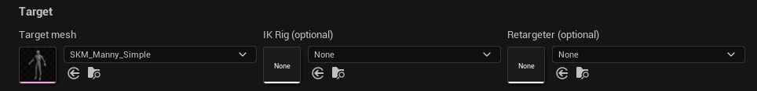

- **Skeletal Mesh**(필수), **IK Rig**(선택), **Retargeter**(선택)를 썸네일과 함께 한 줄에 고릅니다.
- IK Rig를 비우면 같은 스켈레톤의 IK Rig를 찾고, 없으면 UE 자동 캐릭터화로 만듭니다.
- Retargeter를 지정하면 자동 체인 매핑 대신 그 에셋의 설정(루트 모션 포함)을 그대로 씁니다.
- 마지막으로 고른 값은 다음에 패널을 열 때 유지됩니다.

### Prompt (오른쪽 아래)

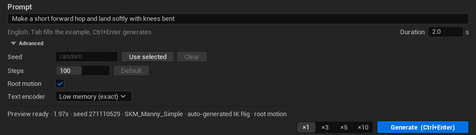

- **동작 설명**(영어). 빈 칸에서 `Tab`을 누르면 예시 문장이 들어갑니다. 길게 쓰면 입력칸 안에서 스크롤됩니다.
  - 한국어로 쓰려면 [프롬프트 해석](#설정-항목)(InterpretAgents)을 설정해야 합니다. 설정이 없으면 영어만 받습니다.
- **Duration**: 초 단위(최소 0.1초). 입력칸 아래 줄 오른쪽에 있습니다.
- **×1 / ×3 / ×5 / ×10** (Generate 버튼 바로 왼쪽): Generate 한 번에 만들 테이크 수. 같은 프롬프트로 시드만 바꿔 차례로 생성하고, 끝나면 Takes 목록에서 비교해 고릅니다.
  - 해석은 한 번만 하고, 두 번째부터는 임베딩 캐시와 메모리에 남은 모델을 써서 테이크당 약 4초(RTX 5060, 2초 클립 기준)가 걸립니다.
  - Seed를 비우면 테이크마다 무작위, 넣으면 `seed, seed+1, …`을 씁니다.
  - 진행 중에는 `Take 2/5`처럼 표시되고, Cancel하면 이미 만든 테이크는 남습니다. Revise는 항상 1개입니다.

  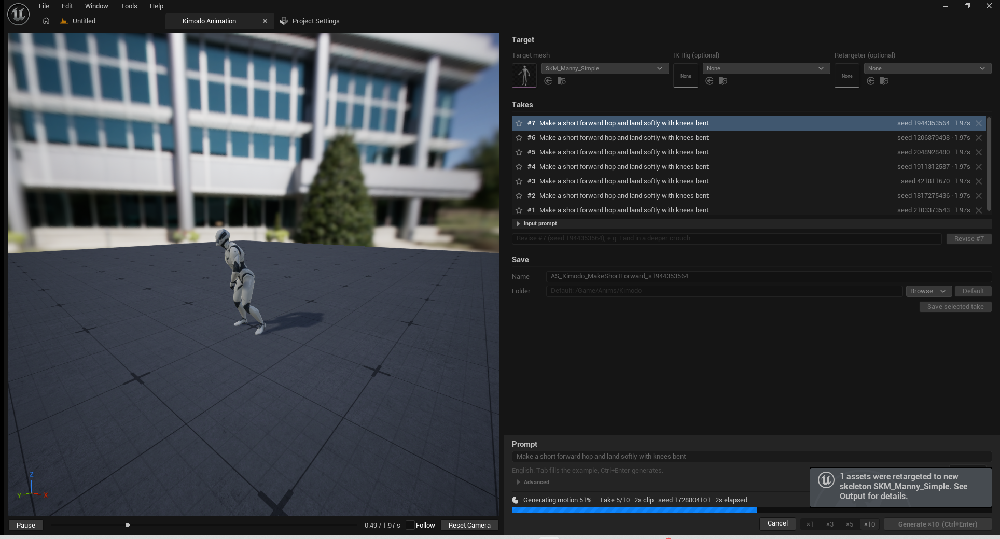

- **Advanced**(기본은 접힘, 펼친 상태는 다음에 패널을 열 때도 유지):
  - **Seed**: 비우면 무작위. 숫자를 넣으면 같은 결과를 재현. `Use selected`는 고른 테이크의 시드를, `Clear`는 비우기
  - **Steps**: 확산(디노이징) 스텝 수. 기본 100(`Default`로 되돌림). 적을수록 빠르고 거칠어집니다. 같은 시드라도 스텝이 다르면 다른 동작이 나오므로, 결과를 재현하려면 시드·스텝·길이·모델이 모두 같아야 합니다. 100이 아닌 테이크는 상태 줄에 `· 20 steps`처럼 표시됩니다.
  - **Root motion**: [루트 모션](#루트-모션) 참고
  - **Text encoder**: [텍스트 인코더와 메모리](#텍스트-인코더와-메모리) 참고

### Takes

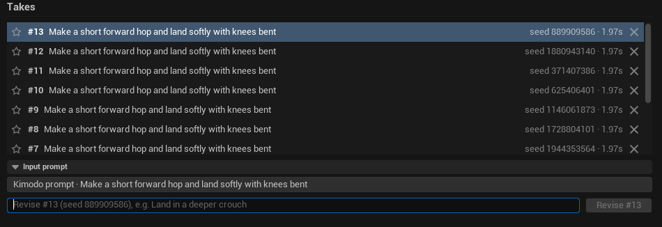

- 생성할 때마다 한 줄씩 쌓입니다(별표 없는 테이크 최대 **20개** + 별표 테이크는 개수 제한 없음). 각 줄: ☆ 별표, 번호, 프롬프트, 시드·길이, 저장 여부 ✓, ✕ 삭제
- **클릭**: 미리보기 전환(바로 바뀜, 다시 리타게팅하지 않음)
- **☆ 별표**: 오래된 테이크가 정리될 때도 남김. 별표 테이크는 20개 제한에 세지 않습니다
- **✕**: 목록과 캐시 파일에서 삭제
- **Input prompt**(접힘): 고른 테이크를 만들 때 Kimodo에 실제로 보낸 프롬프트(해석을 썼다면 해석 결과)를 보여 줍니다. 드래그해 `Ctrl+C`로 복사할 수 있습니다.
- **Revise**(수정 칸에서 `Enter`): 고른 테이크를 기준으로 “조금 더 높이 점프” 같은 수정 요청을 덧붙여 다시 생성. 시드는 유지됩니다.
  - 버튼(`Revise #7`)과 수정 칸 안내문(`Revise #7 (seed 1234), …`)에 기준 테이크가 표시됩니다. 테이크를 고르지 않았으면 수정 칸이 꺼져 있습니다.

  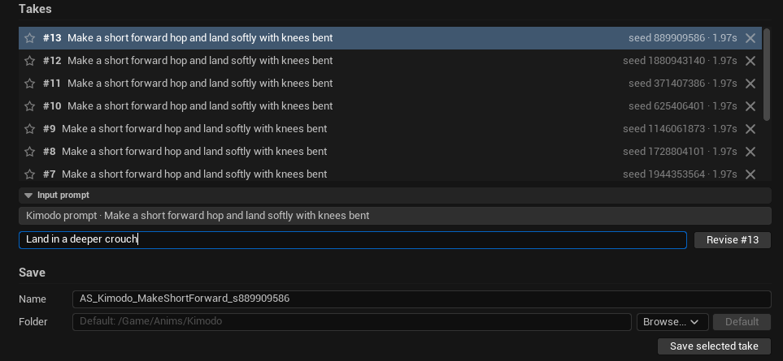

### Body keys (손·발·골반 키프레임)

프롬프트만으로 원하는 위치·크기가 안 나올 때, 고른 테이크를 기준으로 **특정 시각에 손·발·골반이 있어야 할 위치**를 정해 다시 생성합니다(Kimodo end-effector 제약).

- 정할 수 있는 부위: **RH 오른손, LH 왼손, RF 오른발, LF 왼발, Hip 골반**. Kimodo가 위치를 받는 부위는 이 다섯뿐이라 머리·팔꿈치 등은 따로 정할 수 없습니다.
- 키 하나는 "그 시각에 그 부위의 위치(기준 위치 + 오프셋)·회전(기준 그대로)과 몸의 바닥 위치·높이·방향(기준 그대로)"을 고정합니다. **나머지 본(팔꿈치, 어깨, 허리, 머리…)은 고정하지 않고 Kimodo가 맞춰 새로 만듭니다.** 키 사이 시간도 자유입니다.
- 골반 키는 몸 전체 위치·높이를 같이 옮깁니다(예: 위로 -20 cm → 무릎을 굽혀 앉는 쪽). 측정: 골반 -20 cm → 20.1 cm 내려감, 오른발 앞 +20 cm → 21.3 cm 이동.

1. 기준이 될 테이크를 고릅니다(손 동작이 비슷한 것일수록 좋음).
2. Takes 아래 **Body keys (hands, feet, hips)**를 펼치고 키를 추가합니다.
   - **+ Key at playhead**: 미리보기를 원하는 시각에 멈추고 누르면 그 시각에 키가 생깁니다(기본 오른손).
   - 각 줄: ◉ 선택, 시각(초), 부위(RH/LH/RF/LF/Hip), 오프셋 cm(**오른쪽 / 위 / 앞**, 캐릭터 기준. 음수는 왼쪽·아래·뒤), ✕ 삭제
   - **Big wave preset**: 오른손을 0.6초마다 좌우 30 cm씩 옮기는 키를 채웁니다(크고 느린 "안녕" 손 흔들기).
   - **미리보기에서 끌어서 정하기**: 줄 맨 앞 ◉로 키를 고르면 미리보기가 그 시각으로 가고, 손 목표 위치에 **노란 십자 핸들**이 보입니다. 핸들을 좌클릭으로 끌면 카메라와 마주 보는 평면에서 움직이고, 그 키의 cm 값이 바로 바뀝니다. 앞뒤로 옮기려면 카메라를 옆으로 돌려서 끕니다. 핸들 밖을 끌면 평소처럼 카메라가 돕니다.
   - 다른 키의 목표는 하늘색 십자로, 고른 키는 기준 손 위치(흰 십자)에서 목표까지 선으로 보입니다.
3. **Generate with keys (#N)**: 그 테이크의 프롬프트·시드·길이·스텝 그대로, 손만 키 위치로 옮겨 새 테이크를 만듭니다. 이름은 `원래 프롬프트 → 5 hand keys`.

- 오프셋은 **기준 테이크의 그 시각 손 위치에서** 얼마나 옮길지입니다. 그 시각의 전신 자세는 기준 테이크 것을 씁니다.
- 손마다 키는 20개 미만(Kimodo 권장). 키 사이 간격이 넓으면(0.8초 이상) 그 사이에 Kimodo가 동작을 더 넣을 수 있어, 0.5~0.7초 간격이 안정적입니다.
- 정확히 그 위치에 닿지는 않습니다(측정: 목표에서 2~8 cm). 모양을 잡는 용도입니다.
- 예: "A person waves hello with big slow side to side arm movements, right arm raised high" seed 4 → Big wave preset: 흔드는 폭 25 cm·반 왕복 0.35초 → **67 cm·0.59초**.
- 1.1.1 이전 테이크는 기준 파일이 없어 쓸 수 없습니다(다시 생성하면 됨).

### Save

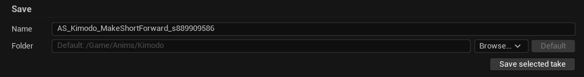

- **Name**: 프롬프트와 시드로 자동 제안(`AS_Kimodo_WaveRightHand_s11`, 이미 있으면 `_2`). 직접 고치면 덮어쓰지 않습니다.
- **Folder**: `Browse`로 콘텐츠 폴더 선택, `Default`는 프로젝트 설정의 출력 폴더. 마지막으로 저장한 폴더를 기억합니다.
- **Save selected take**: 고른 테이크를 `AnimSequence`로 복사해 저장합니다. 테이크 목록은 그대로 남습니다.

### 단축키와 알림

| 키 | 동작 |
|---|---|
| `Ctrl+Enter` | Generate |
| `Enter` (수정 칸) | Revise |
| `Tab` (빈 입력 칸) | 예시 문장 입력 |

생성이 끝나거나 실패하면 에디터 오른쪽 아래에 알림이 뜹니다(다른 창을 보고 있어도 됨).

---

## 루트 모션

Kimodo는 이동(앞으로 걷기, 점프해서 나아가기 등)을 모두 **pelvis**에 넣고 root 본은 움직이지 않습니다.
그래서 기본 상태에서는 root가 원점에 고정되고 pelvis만 이동합니다.

| `Advanced > Root motion` | 결과 | 용도 |
|---|---|---|
| **끔**(기본) | root 고정, 이동은 pelvis에 남음 | 제자리 루프(걷기 사이클 등), 블렌드 스페이스 |
| **켬** | pelvis의 수평 이동으로 root 이동을 만들고 바닥 높이에 붙임. 시퀀스의 `Enable Root Motion`도 켬 | 캐릭터를 실제로 이동시키는 동작(몽타주, 루트 모션 기반 이동) |

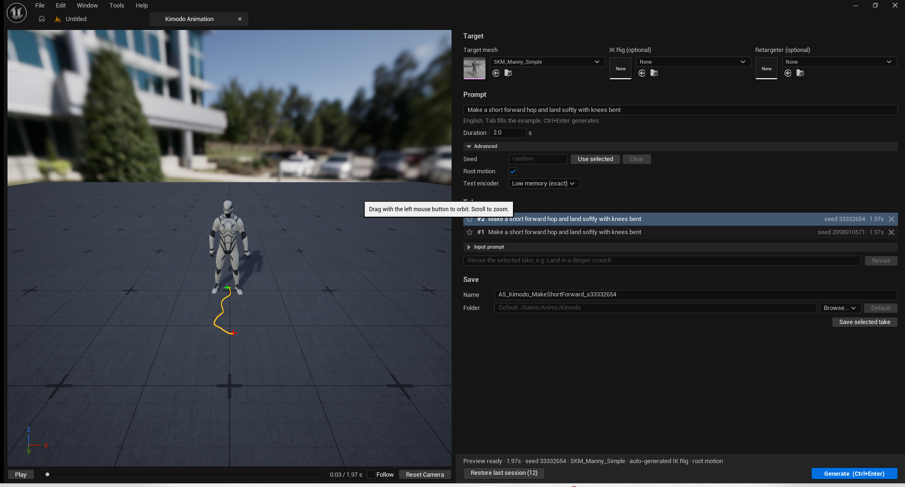

- 켜고 만든 테이크는 상태 줄에 `· root motion`이 붙고, 미리보기에서 캐릭터가 이동하며 경로가 그려집니다.
- 설정은 **새로 만드는 테이크**에 적용됩니다. 이미 만든 테이크는 바뀌지 않습니다.
- Retargeter를 직접 지정하면 그 에셋의 Root Motion 설정을 따릅니다.

---

## 테이크와 저장 위치

- 테이크 미리보기 클립은 **`Saved/Kimodo/TakeAssets`**에 실제 에셋 파일로 남습니다. 에디터에서는 **`/KimodoTakes/Preview`**로 보입니다.
  - 이름: `T<번호>_<핵심 단어>_s<시드>_<id 4자리>`, 예: `T03_WalkForwardFour_s7_a1b2`
  - `Content` 폴더나 소스 관리에 섞이지 않습니다.
- 테이크 목록은 `Saved/Kimodo/session_takes.json`에 저장됩니다.
- 에디터를 다시 열면 **Restore last session (N)**으로 이전 테이크를 **모두** 되살립니다. 캐시 파일을 여는 것뿐이라 테이크 수십 개도 1초 안에 끝납니다.
- 캐시 파일은 테이크를 **✕로 지울 때만** 삭제됩니다. 별표 없는 테이크가 20개를 넘으면 그중 가장 오래된 것부터 목록과 함께 정리됩니다(별표 테이크는 남음).
- 계속 쓸 애니메이션은 반드시 **Save**로 `/Game/...`에 저장하세요. 테이크 캐시는 작업용입니다.
- 이전 버전에서 만든 테이크 캐시(`/KimodoTakes/<id>/KimodoPreview`, `Take_<id>`)는 패널을 처음 열 때 자동으로 새 이름으로 옮겨집니다.

---

## 텍스트 인코더와 메모리

Kimodo는 프롬프트를 **Llama 3 8B**(LLM2Vec) 텍스트 인코더로 4096차원 벡터로 바꿉니다. 모델 전체가 약 16 GB라, 그대로 올리면 일반 PC에서는 메모리가 부족합니다.
이 플러그인은 기본으로 **층을 하나씩 디스크에서 읽어 계산하는 방식**을 씁니다.

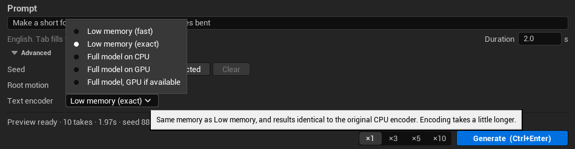

| Text encoder (패널 메뉴 이름) | 최대 RAM | 생성 1회 | 결과 |
|---|---|---|---|
| **Low memory (fast)** (기본) | 약 2.6 GB | 약 42초 | 원래 방식 대비 관절 위치 평균 약 0.5 cm(최대 약 2 cm) 차이 |
| **Low memory (exact)** | 약 2.8 GB | 약 40초 | 원래 CPU 방식과 비트 단위로 동일 |
| Full model on CPU | 약 15.6 GB | 약 56초 | 기준 |
| Full model on GPU | VRAM 16 GB 이상 필요 | GPU에 따라 다름 | VRAM이 부족하면 매우 느려지거나 실패 |
| Full model, GPU if available | CUDA를 쓸 수 있으면 GPU, 아니면 CPU | | VRAM 크기는 확인하지 않음 |

측정: RTX 5060 8 GB, RAM 31 GB, NVMe SSD, 2초 클립 생성 전체 시간(프로세스 최대 메모리).

- **임베딩 캐시**: 같은 프롬프트의 임베딩은 `<model-cache>/kimodo-text-embeddings`에 저장됩니다. 시드·길이만 바꿔 다시 생성하면 인코더를 아예 돌리지 않습니다.
- **Kimodo 상주**: 첫 생성 때 Kimodo 모델을 별도 프로세스(`kimodo_worker.py`)에 한 번 불러 두고, 이후 생성은 로딩 없이 바로 합니다(테이크당 약 17초 → 약 4초).
  - 쓰는 동안 GPU 메모리(VRAM)와 RAM을 차지합니다. 처음 보는 프롬프트를 인코딩한 뒤에는 Low memory 인코더(1~2 GB)도 남겨 둡니다. CPU·CUDA 인코더(약 16 GB)는 생성이 끝나면 바로 내립니다.
  - **10분 동안 생성하지 않거나, 패널 탭을 닫거나, 에디터를 끄면** 프로세스를 끝내 메모리를 돌려줍니다. 테이크 목록은 그대로 남습니다.
  - 생성 중 Cancel해도 모델은 내리지 않습니다. 취소한 생성은 뒤에서 마저 끝나고(보통 몇 초) 결과만 버립니다. 그 사이 새로 생성하면 상태 줄에 `Finishing the cancelled take`가 잠깐 보인 뒤 바로 이어집니다.
  - 같은 시드면 예전 방식(생성마다 새 프로세스)과 BVH가 바이트 단위로 같습니다.
  - 워커 로그: `<작업 폴더>/KimodoWorker.log`
- 패널의 `Advanced > Text encoder`나 `Project Settings > Plugins > Kimodo Animation (Local) > Text Encoder Device`에서 바꿉니다.
- 설치 때 `nvidia-smi`가 없으면 CPU용 PyTorch를 받습니다. 직접 고르려면 환경변수 `KIMODO_TORCH_INDEX`에 PyTorch 인덱스 URL을 지정합니다.

---

## 설정 항목

### Project Settings > Plugins > Kimodo Animation (프로젝트 공용, `DefaultEditor.ini`)

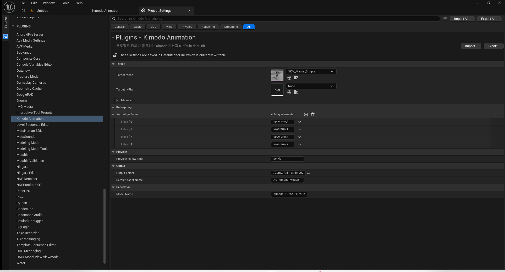

| 항목 | 설명 |
|---|---|
| Target Mesh | 패널을 처음 열 때 고를 대상 메시 |
| Target IK Rig | 대상 IK Rig. 비우면 자동으로 찾거나 생성 |
| Retargeter (고급) | 지정하면 자동 체인 매핑 대신 사용 |
| Auto Align Bones | A/T 포즈 차이를 맞출 대상 본(기본 팔 본). 대상에 없는 본은 무시 |
| Preview Follow Bone | 미리보기 Follow가 따라갈 본(기본 `pelvis`) |
| Output Folder | 기본 저장 폴더(기본 `/Game/Kimodo`) |
| Default Asset Name | 기본 저장 이름 |
| Model Name | Kimodo 모델 이름(`Kimodo-SOMA-RP-v1.2`) |

### Project Settings > Plugins > Kimodo Animation (Local) (PC별, `EditorPerProjectUserSettings.ini`)

| 항목 | 설명 | 환경변수(우선) |
|---|---|---|
| Python Executable | Kimodo venv의 `python.exe`. 비우면 `%LOCALAPPDATA%\KimodoAnimation\venv` | `KIMODO_PYTHON` |
| Model Cache Directory | Hugging Face 모델 캐시. 비우면 `%LOCALAPPDATA%\KimodoAnimation\model-cache` | `KIMODO_MODEL_CACHE` |
| Working Directory | 작업 로그·중간 파일. 비우면 `Saved/Kimodo` | `KIMODO_WORK_DIR` |
| Interpret Agents | 프롬프트를 다듬을 CLI 순서(`codex`, `claude`, `gemini`). 비우면 프롬프트를 그대로 사용 | `KIMODO_AGENTS` |
| Text Encoder Device | 위 표 참고 | |
| Root Motion | 패널의 `Advanced > Root motion`과 같은 값 | |
| Diffusion Steps | 패널의 `Advanced > Steps`와 같은 값(1~1000, 기본 100) | |

**프롬프트 해석(선택)**: `Interpret Agents`에 설치된 CLI(예: `claude`)를 지정하면, 한국어 등 자유로운 요청을 Kimodo가 잘 이해하는 짧은 영어 동작 설명으로 바꾼 뒤 생성합니다. 해석 결과는 Takes의 Input prompt에 표시됩니다. 지정한 CLI가 모두 실패하면 원래 프롬프트를 그대로 씁니다(이때는 영어여야 함).

---

## 파일과 폴더

| 위치 | 내용 |
|---|---|
| `%LOCALAPPDATA%\KimodoAnimation\venv` | Kimodo용 Python 환경(PyTorch, kimodo) |
| `%LOCALAPPDATA%\KimodoAnimation\model-cache` | Llama 3, LLM2Vec, Kimodo 모델과 프롬프트 임베딩 캐시 |
| `<프로젝트>/Saved/Kimodo/PanelJobs/<id>/` | 생성 작업별 로그(`Interpretation.log`, `Kimodo.log`, `Setup.log`)와 결과 `SOMA_Motion.glb`. 최근 20개(테이크가 참조하는 작업 포함)만 유지 |
| `<프로젝트>/Saved/Kimodo/TakeAssets/` | 테이크 미리보기 캐시(`/KimodoTakes/Preview`) |
| `<프로젝트>/Saved/Kimodo/session_takes.json` | 테이크 목록 |
| 저장 폴더(`/Game/Kimodo` 등) | Save로 만든 `AnimSequence` |
| `<작업 폴더>/KimodoWorker.log` | 메모리에 띄워 둔 Kimodo 프로세스의 로그 |

### 개발: 자동 테스트

플러그인을 고칠 때는 [`Tests/`](Tests/README.md)의 테스트로 회귀를 확인합니다.

```powershell
powershell -ExecutionPolicy Bypass -File Tests\run_tests.ps1          # 단위 테스트(약 1초, Unreal·Kimodo 불필요)
powershell -ExecutionPolicy Bypass -File Tests\run_tests.ps1 -All     # 단위 + Kimodo 통합 + 헤드리스 에디터(약 10분)
```

---

## 문제 해결

| 증상 | 해결 |
|---|---|
| `This Hugging Face token cannot download Llama 3` | Llama 3 라이선스 승인이 끝났는지, 토큰이 같은 계정의 **Read** 토큰인지 확인 |
| `Access to <repo> was denied` | 해당 Hugging Face 페이지에서 라이선스를 승인 |
| 빌드된 zip을 넣었는데 “KimodoAnimation 모듈을 다시 빌드할까요?” / “다른 엔진 버전으로 빌드됨” | 엔진이 5.8.0이 아님(다른 핫픽스). 소스 zip으로 바꾸고 Visual Studio로 빌드 |
| 설치가 “building from source”로 넘어가고 실패 | `Wheels/*.whl`이 약 28 MB인지 확인. 작다면 Releases의 `KimodoAnimation-<버전>.zip`을 다시 받거나, 프로젝트를 클론했다면 `git lfs pull`. 소스 빌드에는 Visual Studio C++, CMake, Git이 필요 |
| `Write the Kimodo prompt in English.` | 영어로 쓰거나 `Interpret Agents`를 설정 |
| `Kimodo is not installed on this computer` | 패널에서 Install Kimodo 실행. 경로를 바꿨다면 Local 설정의 Python/모델 캐시 경로 확인 |
| `Unreal could not characterize <mesh>` | 표준 휴머노이드가 아닌 메시. Target IK Rig(리타게팅 체인 포함)를 직접 지정 |
| `No retarget chain of <rig> matched the SOMA skeleton` | IK Rig 체인 이름을 표준(Spine, Head, LeftArm, LeftLeg…)으로 바꾸거나 Retargeter를 지정 |
| 팔이 몸을 뚫거나 벌어짐 | `Auto Align Bones`에 대상의 상완·전완 본 이름을 지정 |
| 생성이 매우 느리거나 메모리 부족 | Text encoder를 `Low memory`로. CUDA는 VRAM 16 GB 이상에서만 |
| 실패 원인을 더 보고 싶음 | 알림/상태 줄에 나온 로그 경로(`Saved/Kimodo/PanelJobs/<id>/*.log`) 확인 |
| 루트 모션 클립이 게임에서 제자리 | 캐릭터의 Anim Blueprint `Root Motion Mode`가 `Root Motion from Everything`인지(몽타주면 Montages Only도 가능) 확인 |

---

## 제한 사항

- **Windows 64-bit, UE 5.8** 전용 에디터 플러그인입니다. 런타임(패키징된 게임)에는 포함되지 않습니다.
- 생성은 **사람 형태(휴머노이드) 동작**만 다룹니다. 손가락은 대략적인 수준입니다.
- 한 번에 한 작업만 실행됩니다(생성 중에는 다른 테이크 선택·저장 불가, Cancel 가능).

Kimodo 모델 자체의 한계:

> **출처**: NVIDIA, *Kimodo Documentation* — [Best Practices](https://research.nvidia.com/labs/sil/projects/kimodo/docs/key_concepts/limitations.html)의 Limitations 항목, [Quick Start](https://research.nvidia.com/labs/sil/projects/kimodo/docs/getting_started/quick_start.html)의 모델 표. 2026-11-24 확인. 후처리·제약·모델 호환 관련 문장 중 이 플러그인의 동작 설명은 플러그인 코드 기준입니다.

- **길이**: 한 프롬프트로 만드는 동작은 **최대 10초**입니다.
- **복잡한 프롬프트**: 한 문장에 동작이 많을수록 의도가 흐려집니다. [프롬프트 작성 요령](#프롬프트-작성-요령)을 참고하세요.
- **학습 범위 밖의 동작**: 학습 데이터에 없는 동작(특정 스포츠 기술 등)은 품질이 크게 떨어집니다.
- **발 미끄러짐**: 모델 원본 출력에는 발이 바닥에서 미끄러지는 현상(foot skating)이 남을 수 있습니다. 이 플러그인은 Kimodo 후처리를 끄고(`--no-postprocess`) 생성합니다.
- **이어 붙이기**: Kimodo의 키프레임·경로 제약과 여러 프롬프트 타임라인 기능은 이 패널에서 지원하지 않습니다. 긴 장면은 테이크를 따로 만들어 시퀀서나 몽타주에서 블렌딩합니다.
- **모델**: `Model Name`에는 SOMA 스켈레톤 모델(`Kimodo-SOMA-RP-v1.2` 기본, RP 계열 권장)만 씁니다. G1(로봇), SMPL-X 모델은 리타게팅 경로가 SOMA 기준이라 맞지 않습니다.

---

## 제거

1. 프로젝트에서 `Plugins/KimodoAnimation`을 지우거나 플러그인을 끕니다.
2. 디스크를 비우려면 `%LOCALAPPDATA%\KimodoAnimation\`(약 20 GB)과 `<프로젝트>/Saved/Kimodo/`를 삭제합니다.
3. Hugging Face 토큰은 필요 없으면 Hugging Face 설정에서 폐기합니다.

---

## 라이선스

- 플러그인 코드(`Source/`, `Scripts/`): [MIT](LICENSE) © 2026 Garagekeeper
- 동봉한 `kimodo` 휠: Apache-2.0 ([ThirdParty/kimodo/LICENSE](ThirdParty/kimodo/LICENSE))
- 설치 때 내려받는 Llama 3, LLM2Vec, Kimodo 모델은 각 배포처의 라이선스를 따르며, 사용자가 직접 승인하고 받습니다. 생성한 애니메이션의 사용도 그 조건을 따릅니다. 자세한 내용은 [THIRD_PARTY_NOTICES.md](THIRD_PARTY_NOTICES.md)를 보세요.

### 참고 자료

- Kimodo 저장소: https://github.com/nv-tlabs/kimodo
- Kimodo 문서 — Quick Start: https://research.nvidia.com/labs/sil/projects/kimodo/docs/getting_started/quick_start.html
- Kimodo 문서 — Best Practices / Limitations: https://research.nvidia.com/labs/sil/projects/kimodo/docs/key_concepts/limitations.html
- Kimodo 기술 보고서(PDF): https://research.nvidia.com/labs/sil/projects/kimodo/assets/kimodo_tech_report.pdf
- BONES-SEED 데이터셋: https://huggingface.co/datasets/bones-studio/seed

이 README의 [프롬프트 작성 요령](#프롬프트-작성-요령)과 [제한 사항](#제한-사항) 일부는 위 Kimodo 문서를 요약한 것입니다.
